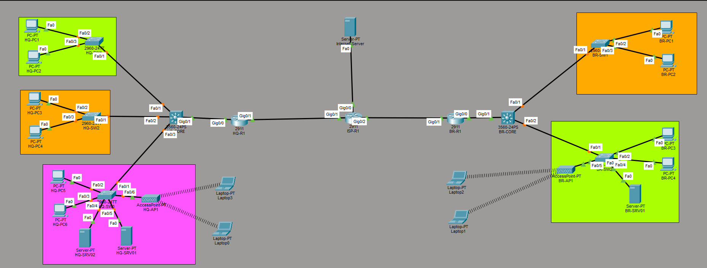

# LankaTech Enterprise Network

A multi-site enterprise network simulation designed and implemented in
**Cisco Packet Tracer** for the fictional company **LankaTech
Solutions**.

The project models a realistic enterprise environment with a **Colombo
Headquarters**, **Kandy Branch**, ISP connectivity, departmental VLANs,
centralized DHCP/DNS services, an internal web server, inter-VLAN
routing, and branch-to-HQ/WAN connectivity.

## Network Topology



## Sites

  Site            Location    Network
  --------------- ----------- -------------------------------------
  Headquarters    Colombo     `10.10.0.0/16`
  Branch          Kandy       `10.20.0.0/16`
  WAN / Transit   ISP links   `172.16.0.0/30` and `172.16.1.0/30`

## Objectives

-   Design a realistic multi-site enterprise network.
-   Separate departments using VLANs.
-   Implement Layer 3 inter-VLAN routing.
-   Provide centralized DHCP services.
-   Provide internal DNS resolution.
-   Host an internal company web portal.
-   Connect the Colombo HQ and Kandy branch through an ISP/WAN.
-   Validate connectivity using practical network tests.

## Architecture

### Colombo Headquarters

-   `HQ-R1` --- Cisco 2911 edge router
-   `HQ-CORE` --- Cisco 3560 multilayer switch
-   `HQ-SW1`, `HQ-SW2`, `HQ-SW3` --- Cisco 2960 access switches
-   `HQ-SRV01` --- DNS + Web server
-   `HQ-SRV02` --- DHCP server
-   `HQ-AP1` --- Wireless access point

### Kandy Branch

-   `BR-R1` --- Cisco 2911 edge router
-   `BR-CORE` --- Cisco 3560 multilayer switch
-   `BR-SW1`, `BR-SW2` --- Cisco 2960 access switches
-   `BR-SRV01` --- Branch server
-   `BR-AP1` --- Wireless access point

### ISP / Internet Simulation

-   `ISP-R1` --- Cisco 2911
-   `Internet-Server` --- simulated external server

## VLAN Design

### Headquarters

    VLAN Name                 Subnet            Gateway
  ------ -------------------- ----------------- --------------
      10 Management           `10.10.10.0/24`   `10.10.10.1`
      20 HR                   `10.10.20.0/24`   `10.10.20.1`
      30 Finance              `10.10.30.0/24`   `10.10.30.1`
      40 Sales                `10.10.40.0/24`   `10.10.40.1`
      50 IT                   `10.10.50.0/24`   `10.10.50.1`
      60 Voice                `10.10.60.0/24`   `10.10.60.1`
      70 Guest                `10.10.70.0/24`   `10.10.70.1`
      80 Servers              `10.10.80.0/24`   `10.10.80.1`
      99 Network Management   `10.10.99.0/24`   `10.10.99.1`

### Kandy Branch

    VLAN Name                 Subnet            Gateway
  ------ -------------------- ----------------- --------------
      10 Management           `10.20.10.0/24`   `10.20.10.1`
      40 Sales                `10.20.40.0/24`   `10.20.40.1`
      50 IT                   `10.20.50.0/24`   `10.20.50.1`
      70 Guest                `10.20.70.0/24`   `10.20.70.1`
      80 Servers              `10.20.80.0/24`   `10.20.80.1`
      99 Network Management   `10.20.99.0/24`   `10.20.99.1`

## Core Services

### DHCP

`HQ-SRV02` provides centralized DHCP.

**HQ pools:** `HR_POOL`, `FINANCE_POOL`, `SALES_POOL`, `IT_POOL`,
`GUEST_POOL`

**Branch pools:** `BR_SALES_POOL`, `BR_IT_POOL`, `BR_GUEST_POOL`

DHCP relay using `ip helper-address` is configured on the appropriate
Layer 3 VLAN interfaces.

### DNS

`HQ-SRV01` provides internal DNS.

  Hostname                     Address
  ---------------------------- ---------------
  `dns.lankatech.local`        `10.10.80.20`
  `intranet.lankatech.local`   `10.10.80.20`

### Internal Web Portal

The internal web server is hosted on `HQ-SRV01`.

**URL:** `http://intranet.lankatech.local`

## WAN and Routing

### HQ

-   `HQ-CORE` ↔ `HQ-R1`: `172.16.1.0/30`
-   `HQ-R1` ↔ `ISP-R1`: `172.16.0.0/30`

### Branch

-   `BR-CORE` ↔ `BR-R1`: `172.16.1.4/30`
-   `BR-R1` ↔ `ISP-R1`: `172.16.0.4/30`

### Internet Simulation

-   `ISP-R1` ↔ `Internet-Server`: `172.16.0.8/30`

The current implementation uses static routing for site-to-site and
Internet-server connectivity.

## Inter-VLAN Routing

Layer 3 switching is implemented on the Cisco 3560 multilayer switches.

`ip routing` is enabled on:

-   `HQ-CORE`
-   `BR-CORE`

SVIs provide the default gateways and route traffic between VLANs.

## DHCP Relay Architecture

The centralized DHCP design allows clients at both sites to obtain
addresses from `HQ-SRV02`.

``` text
Branch Client
     |
Branch Access Switch
     |
BR-CORE
     |
BR-R1
     |
ISP-R1
     |
HQ-R1
     |
HQ-CORE
     |
HQ-SRV02 (DHCP)
```

## Validation

The following tests have been successfully performed:

-   HQ clients obtain DHCP addresses.
-   Branch Sales clients obtain DHCP addresses.
-   DHCP relay forwards requests to the centralized DHCP server.
-   Branch clients reach their local VLAN gateway.
-   Branch clients reach `HQ-SRV01`.
-   Branch clients resolve `intranet.lankatech.local`.
-   Branch clients reach the simulated `Internet-Server`.
-   HQ clients reach the simulated Internet server.
-   Inter-site routing has been validated with ICMP tests.

## Technologies

-   Cisco Packet Tracer
-   Cisco IOS
-   IPv4
-   VLANs
-   802.1Q trunking
-   Layer 3 switching
-   Inter-VLAN routing
-   DHCP
-   DHCP relay
-   DNS
-   HTTP
-   Static routing
-   Wireless LAN simulation

## Project Status

### Implemented

-   [x] Multi-site topology
-   [x] HQ network
-   [x] Kandy branch network
-   [x] ISP / Internet simulation
-   [x] VLAN segmentation
-   [x] Layer 3 inter-VLAN routing
-   [x] Centralized DHCP
-   [x] DHCP relay
-   [x] Internal DNS
-   [x] Internal web server
-   [x] HQ-to-branch connectivity
-   [x] Internet-server connectivity
-   [x] Network validation

### Planned Enhancements

-   [ ] OSPF dynamic routing
-   [ ] NAT/PAT for Internet access
-   [ ] Extended ACL security policies
-   [ ] Guest network isolation
-   [ ] Additional wireless security and validation
-   [ ] Network monitoring and management
-   [ ] Redundancy and high-availability improvements

## Learning Outcomes

This project demonstrates practical experience with:

-   Enterprise network topology design
-   IP addressing and subnetting
-   VLAN planning
-   Layer 2 switching
-   Layer 3 routing
-   DHCP architecture
-   DNS configuration
-   WAN connectivity
-   Network troubleshooting
-   Cisco IOS configuration
-   Packet Tracer network simulation

## Author

**Gamindya**

Bachelor of ICT --- University of Colombo

------------------------------------------------------------------------

> This project is a Cisco Packet Tracer simulation created for
> educational and portfolio purposes.
